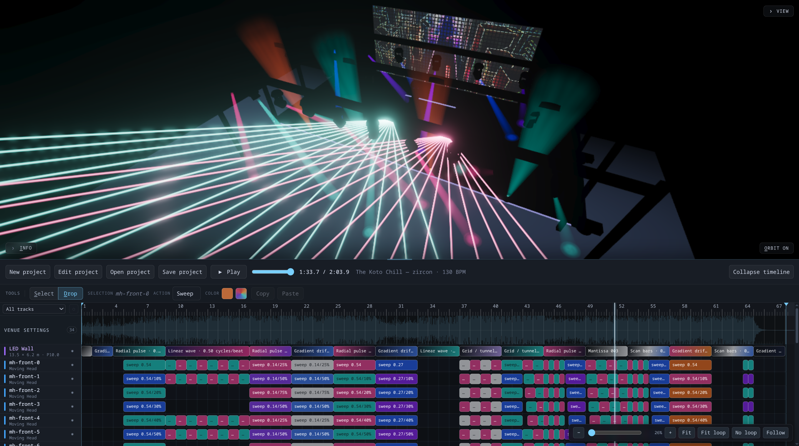

# Lightshow Studio

A browser-based stage-lighting simulator: design lighting effects in time to music, the way a nightclub or DJ rig runs through DMX-controlled fixtures. I made this because I like stage lighting effects but I don't have access to real hardware.



## What you can do

- Load a song
- Build the rig -- place moving heads, washes, PARs, strobes, lasers, and cryo jets around a club/stage venue, then aim them and tune their beam, zoom, and dimmer.
- Program the show -- on a DAW-style timeline: drag out clips to turn lights on, move and resize them to match the beat, and edit color, aim, strobe, and fades per clip.
- Play it back -- with the audio clock: lighting stays synced to the song while you scrub, loop, and switch camera views.
- Save a `.dmxsim` project -- a self-contained ZIP with the rig, arrangement, audio, and any LED-wall images or videos.

### Other cool features
- LED walls support simple generated patterns, pre-generated video loops, or your own custom images/videos uploaded into the app. You can also control the pitch and pixel gap and stuff.

## Coming soon
- Fire effects
- Gobos

## Use of AI
This codebase is completely written with AI, using OpenRouter via VSCode Copilot. It was mainly Deepseek 4.1 Flash 1017 but glm-5.3-flash also contributed a few bugs along the way. 

## Development

```sh
npm install
npm run dev        # runs the studio app
npm test           # unit tests
npm run typecheck
npm run build
```

Requires a WebGPU-capable browser (the renderer falls back to WebGL2 when unavailable).
